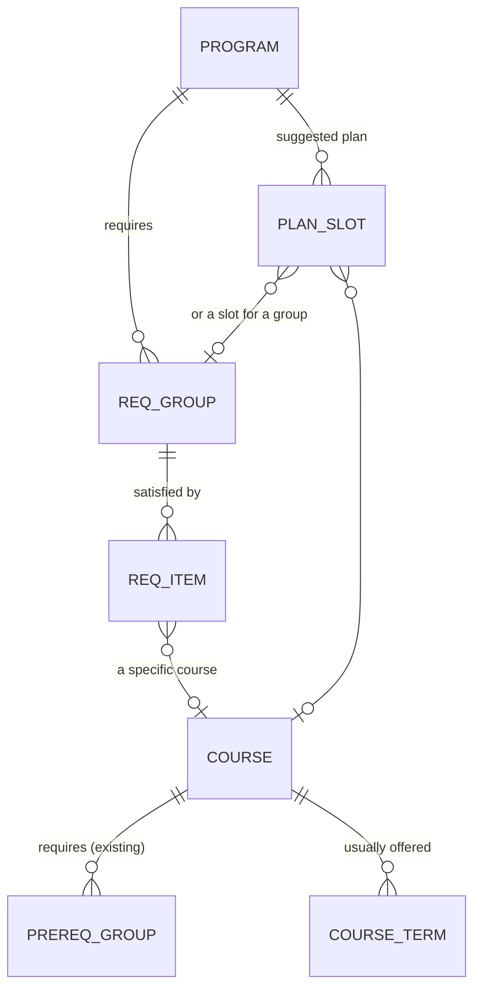

# Visor: Degree audit (design, v0.1 draft)

Status: **draft for team review.** Jira: KAN-48 (design), epic KAN-12.
Builds on the program/requirement tables sketched in `02-design-data-model.md`, now checked against Ms. Hood's real degree plans (received 10/6, reviewed 10/13). Those files stay out of git (`data/private/`); course codes below are from the public catalog.

## What we're building

Ms. Hood's #2 ask: a DegreeWorks-style audit. Given a program and the courses a student has (Lipscomb courses plus transfer courses), show:

1. which requirements are **met**, **in progress**, or **still needed**,
2. hours done vs. hours required, and
3. a rough **projected graduation term**, from placing the remaining courses into future terms while respecting prerequisites.

Transfer courses go through the equivalency table first (`specs/03`). Only a `confirmed` equivalency counts toward the audit. `proposed` ones are shown as "pending" and don't count. This is where the two features connect.

**No student records are stored in v1.** The audit takes the student's course list in the request and returns a result, and nothing is saved. That keeps us out of FERPA storage questions (Brett Hanson) while we build. Test with the two test transcripts, once they're confirmed to be fake test students.

## What the real degree plans look like

All four (CS B.S., SE B.S., AI B.S., Accounting B.B.A.) use the same three sheets:

| Sheet | Contents | Use |
|---|---|---|
| **Degree Plan** | 8-semester grid (Freshman Fall … Senior Spring), Academic Year 2026-27, 126–127 total hours. Cells are free text: `"CS 2233 Data Structures (CS1213 w/C+)"` | The **suggested plan** (`plan_slot`), and min grades from the `w/C+` notes |
| **Lipscomb Core** | The 46-hour university core: SEEK / DISCOVER / KNOW / FLOURISH, with "choose one" menus | **Core requirement groups**, shared by every program |
| **Major** | Course, credits, prereqs (CS/SE/AI); course, credits, **semesters offered** (`F, SP, SU`) for Accounting | **Major requirement groups**, plus prereqs and offered terms |

Data problems to handle (or ask about):
- Placeholders that are requirements, not courses: `CS 3XX3/4XX3 Upper-division Elective` (×3, 9 hrs), `General Elective`, `Social Inquiry (PS, SO, SW, EC, FS, LJS)`, `Christianity and Society` (menu), `Diverse Perspectives` (a tag on courses, not a list), `9 Hours of Accounting Major Electives (See Catalog)`.
- Courses with no number yet (AI): `CS 3xx3 Machine Learning`, `CS 4xx3 Modern AI Models`.
- The two sheets disagree: the CS grid says `CS 2623 Design and Analysis`, the Major sheet says `CS 3623`; Accounting `BA2103 Introduction to Business` vs `ENT 2503`; SE lists `IT 2233` for two different titles; SE `SENG 4233` prereq `SENG2343` looks like a typo.
- Prereq notation is mixed: `MA1123 or MA1135` (OR), `CS2233/MA3213` (AND? unclear), `SENG2513+CS2233` (AND).
- Excel turned the `1-3` internship credits into a date. Variable-credit courses end in `V` (`CCT 395V`).
- `ENGR 1000` (0 hrs) is taken every semester.

**Decision:** the catalog (https://catalog.lipscomb.edu/) is the source of truth, and these sheets are the input. The importer reports every conflict above, and a person resolves it. We don't guess.

## Data model



| Table | Columns | Notes |
|---|---|---|
| **program** | id, name (`Computer Science`), degree (`B.S.`), catalog_year (`2026-27`), total_hours (127) | Unique (name, degree, catalog_year). A student follows the catalog year they entered under. |
| **req_group** | id, program_id (null = Lipscomb Core, shared), name (`Major core`, `Upper-division electives`, `SEEK: Through Scripture`), rule (`all` / `choose_n` / `hours`), n (for choose_n), hours (for hours), sort | One row per "bucket" on the audit. |
| **req_item** | id, req_group_id, course_id (nullable), pattern (nullable, e.g. `{"subjects": ["CS","IT","SEC","SENG","CCT"], "min_level": 3000}`), tag (nullable, e.g. `DP`), min_grade (nullable, `C+`), label | A specific course, *or* a pattern that matches many (electives), *or* a tag. |
| **plan_slot** | id, program_id, term_index (1–8), course_id or req_group_id, credits | The suggested 8-semester grid. |
| **course_term** | course_id, term (`F` / `SP` / `SU`) | From the Accounting "Semester" column; fills in KAN-28. |
| *(existing)* **prereq_group / prereq_item** | add **min_grade** (nullable) to prereq_item | For `w/C+`. |

Rules for counting:
- A course counts toward **one** requirement only. Take the most specific one first: a specific course, then a pattern, then a general elective.
- Course `kind = elective` transfer credit (e.g. `EN2XXT`) can only count toward pattern or general-elective groups whose subject and level match.
- `min_grade` is checked when a grade is given. Transfer credit with no grade counts as passing at the SIS minimum (usually C).

## Rules interface (pure Python, `backend/visor/rules/audit.py`)

Same pattern as the rest of `rules/`: dataclasses in and out, no Flask or DB.

```python
@dataclass(frozen=True)
class Taken:            # one course the student has (Lipscomb or already-translated transfer)
    code: str           # "CS 2233", or an elective code like "EN 2XXT"
    credits: float
    grade: str | None   # None = in progress / transfer with no grade
    source: str         # "lipscomb" | "transfer" | "in_progress"

@dataclass
class GroupResult:
    name: str
    status: str         # met | in_progress | needed
    used: list[str]     # course codes counted here
    remaining: str      # human text: "2 courses", "6 hours of CS/IT/SEC 3000+"

@dataclass
class AuditResult:
    program: str
    hours_done: float
    hours_required: int
    groups: list[GroupResult]
    unused: list[str]           # courses that counted toward nothing
    projected_term: str | None  # e.g. "2028SP"

def audit(program: Program, taken: list[Taken]) -> AuditResult: ...
def project(remaining: list[str], prereqs, offered, start_term: str, max_hours: int = 18) -> dict[str, list[str]]: ...
```

`project()` schedules the remaining specific courses term by term, in prereq order, only in terms they're offered, with at most `max_hours` per term. Electives fill any slack. This reuses `missing_prereqs()` from `rules/conflicts.py`.

## API sketch

| Method | Path | What |
|---|---|---|
| GET | `/api/programs` | List programs + catalog years |
| GET | `/api/programs/<id>` | Requirement groups + suggested plan |
| POST | `/api/audit` | Body: `{program_id, taken: [{code, credits, grade}], transfer: [{school_id, subject, number, grade}]}`. Transfer courses go through the equivalency lookup first. Returns `AuditResult`, plus a `transfer` list showing what each transfer course became (confirmed / pending / unknown). **Nothing is stored.** |

## Getting the data in

`flask import-degree-plan <xlsx>` reads one program's file from `data/private/`:
1. **Major sheet:** specific courses go into a "Major core" group (`all`). `3XX3/4XX3` rows become pattern items. Prereq text is parsed (`or` → OR group, `+` → AND). `/` is ambiguous and reported for a person to decide. Accounting's Semester column fills `course_term`.
2. **Lipscomb Core sheet:** imported once as the shared groups (program_id null).
3. **Degree Plan sheet:** fills `plan_slot`, and its `(... w/C+)` notes fill prereq min grades.
4. Every conflict and unknown is printed as `file/sheet/row: problem`. Nothing ambiguous is guessed. (Same approach as the SIS and catalog importers.)

## Suggested work split (once the team approves this)

| Piece | Fits |
|---|---|
| Tables + importer | Austin (same shape as the SIS importer) |
| `rules/audit.py` + `project()` | Gabriel (rules engine, same as KAN-39) |
| Audit page (pick program, enter courses, see groups) | Firas (fills the "Degree Progress" tab) |

## Questions for Ms. Hood

1. When the degree plan sheet and the catalog disagree (e.g. `CS 2623` vs `CS 3623`), which wins? Is there a newer file?
2. Does `CS2233/MA3213` mean both, or either?
3. Should the audit follow the catalog year a student entered under, or the current one?
4. Is there a list of which courses carry the Diverse Perspectives (DP) tag, and the Social Inquiry / Christianity and Society menus?
5. Do transfer courses with a grade below the program's `min_grade` still count as hours?
6. For v1, is "type in the student's courses" fine, or does she need it to read an unofficial transcript PDF?
